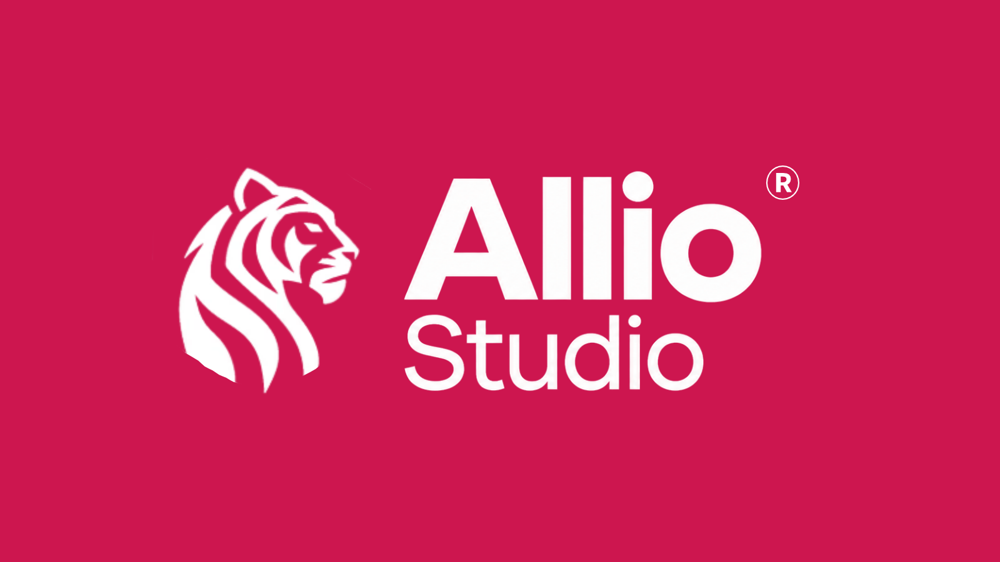

<p align="center"></p>

# AllioEngine

Motor de juegos 2D y 3D de Allio Studio. El editor visual y el renderizador son nativos de C++. Los proyectos nuevos se programan en C# con .NET 10.

## Primer juego

1. Abre `allioengine-editor.exe` y crea un proyecto desde el Hub. Elige una plantilla 2D, 3D o de interfaz.
2. Selecciona un objeto con Transform en la jerarquía. Desde el Inspector puedes crear y adjuntar un script C#.
3. Guarda el script y pulsa **Play**. El editor compila los archivos `.cs` del proyecto y muestra los errores del compilador en la consola de compilación. Detén Play para editar y volver a probar.

Por ejemplo, guarda esta clase en `Mover.cs` y adjúntala a un objeto. La tecla D lo desplaza sobre el eje X.

```csharp
using AllioEngine;
using System.Numerics;

public sealed class Mover : Behaviour
{
    public override void Update(float deltaTime)
    {
        if (IsKeyDown(Key.D))
            Position += Vector3.UnitX * (3f * deltaTime);
    }
}
```

La API de C# incluye el ciclo de vida del componente, posición, rotación, teclado, registro de mensajes y controles de interfaz. El código de la API describe los métodos disponibles. [Behaviour.cs](engine/managed/Allio.Managed/Behaviour.cs)

## Compilar en Windows

Instala el SDK de .NET 10, Python 3, CMake 3.27 o posterior y Visual Studio 2022 con **Desarrollo para el escritorio con C++**. Desde una consola de desarrollo x64 con CMake y Ninja en el PATH, ejecuta estos comandos dentro del repositorio.

```powershell
cmake --preset windows-msvc-release
cmake --build --preset windows-msvc-release
.\build\presets\windows-msvc-release\allioengine-editor.exe
```

Si el repositorio está en `E:\AllioEngine`, este preset guarda allí también los archivos de compilación. En el Hub puedes elegir otra carpeta de E: para tus juegos.

## Exportar

En **File → Build Settings**, elige el escritorio del sistema anfitrión y el método automático o de compilación. El juego exportado necesita el runtime de .NET 10 de la misma arquitectura. Distribuye la carpeta `managed` junto al ejecutable. La exportación de código fuente incluye los scripts y el proyecto `Allio.Game.csproj` para recompilarlos con CMake.

La integración C# está orientada al escritorio. Las exportaciones web, Android e iOS de proyectos con C# quedan fuera de esta versión. El motor conserva Lua para escenas antiguas y para subsistemas heredados, entre ellos parte de la interfaz HTML. Las llamadas Lua existentes requieren adaptación a la API de C#.

## Origen y licencias

AllioEngine parte de JasperEngine, de Arakuma Studio, basado a su vez en Doriax, de Eduardo Doria y colaboradores. Se conservan la licencia MIT y los avisos de las bibliotecas incorporadas. [Repositorio original](https://github.com/Arakuma-Studio/JasperEngine) · [Licencia](LICENSE) · [Créditos y licencias de terceros](NOTICE.md)
